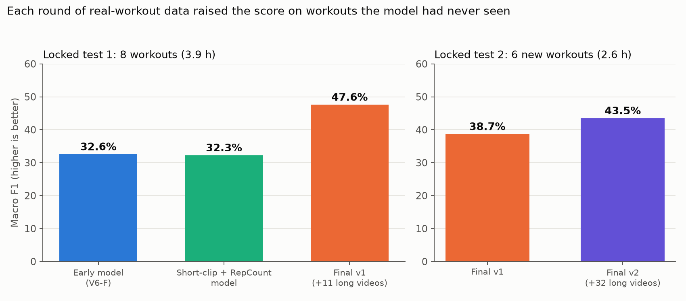
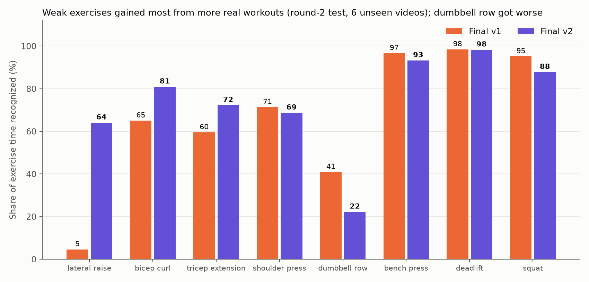
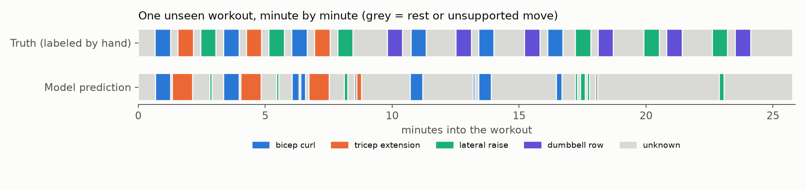

# cALorie — final report

Date: 2026-10-30. Branch: `feat/tcn-rebuild`.

## 1. What cALorie is

cALorie watches a workout video and works out **which exercise is happening, second by second**. It never
looks at raw pixels during recognition. It first extracts the person's body keypoints with MediaPipe, then two
small neural networks read the motion of those keypoints:

```text
video -> MediaPipe pose (17 keypoints, 15 FPS)
      -> gate: "a supported exercise, or something else?"
      -> classifier: "which of the 14 exercises?"
      -> smoothing -> exercise timeline (+ approximate reps and calories in the local page)
```

Supported exercises (14): bench press, bicep curl, deadlift, dumbbell row, jumping jack, lat pulldown, lateral
raise, lunge, pull-up, push-up, shoulder press, sit-up, squat, tricep extension. Everything else (rest,
warm-ups, talking, other moves) should come out as `unknown`.

## 2. What was built, and what was not

| Part | Status |
| --- | --- |
| Pose extraction (MediaPipe, normalized keypoints) | Done |
| Open-set gate (3 TCN streams: joint, bone, velocity) | Done |
| 14-class exercise classifier (TCN) | Done |
| Full-session timeline scoring and smoothing | Done |
| Labeled real-session data (38 workouts, 19 h) and two locked tests | Done |
| Total video turned into pose data | about 34 h: 1,814 short training clips (7.7 h), 1,039 RepCount clips (7.3 h), 38 long workouts (18.8 h) |
| Small local web page (video in, timeline, reps, calories out) | Done, minimal (`ml/app/`) |
| Repetition counting | Done for 5 exercises, approximate (sealed test: 68% of clips within one rep, 39% exact) |
| Calorie estimate (MET-based) | Done, not validated (one fixed MET per exercise, ±35% range) |
| Full app (accounts, history, phone) | **Not built** |

## 3. The final model

The final model (`ml/artifacts/final_model_v2/`, see its `MODEL_CARD.md`) comes from Notebook 47: three seeds
(42, 137, 2026), each a classifier plus three gates, trained on a Colab T4 in three parts. It uses the
Notebook 46 recipe (short-clip pool with RepCount capped at 50% of each class, long-video windows at exactly
25% of each gate class) on **all 32 labeled long videos** (round 1 and round 2). Fixed settings: 64-frame windows
(4.3 s), gate threshold 0.65, mean-probability gate fusion, smoothed decoder (majority vote over 9 windows,
runs under 4 s merged into a neighbor).

The previous final model (v1, Notebook 46, `ml/artifacts/final_model_v1/`) used 11 long videos and is kept as
the baseline. v2 replaced it because it passed all four rules that were written down before scoring.

## 4. Results



### Locked test 2 (the decisive one): 6 unseen workouts from new creators, 2.6 h

Notebook 47 against the previous final model, smoothed, seed medians:

| Rule (set in advance) | v1 | **v2** | Needed | Pass |
| --- | ---: | ---: | ---: | :---: |
| Macro F1 gain | 38.7% | **43.5%** | ≥ +3 pp | yes (+4.8) |
| Mean recall of five weak exercises | 48.3% | **61.7%** | ≥ +10 pp | yes (+13.4) |
| Exercise time called `unknown` | 35.0% | **30.1%** | no worse than +3 pp | yes |
| Rest time called `unknown` | 76.3% | 76.5% | no worse than +5 pp | yes |

The video-bootstrap 95% interval for the Macro F1 gain is +1.9 to +7.8 points. Internal clip test (reused many
times, so only a "did nothing break" check): 85.9% Macro F1 for v2, about 83% for v1.



Time recall, v1 → v2: lateral raise 5 → 64%, bicep curl 65 → 81%, tricep extension 60 → 72%, shoulder press
71 → 69%, bench press 97 → 93%, deadlift 98 → 98%, squat 95 → 88%, **dumbbell row 41 → 22% (worse)**. v2 is
better on 4 of the 6 videos and slightly worse on 2. Lunge, pull-up, push-up, sit-up, lat pulldown, and
jumping jack barely appear in this test, so it says little about them.



### Locked test 1 (8 workouts, 3.9 h; the earlier test)

Used twice for v1; now part of v2's training data, so it is no longer a fair test for v2.

| Smoothed timeline | V6-F (early) | Short-clip model | Final v1 |
| --- | ---: | ---: | ---: |
| Macro F1 (15 labels) | 32.6% | 32.3% | **47.6%** |
| Accuracy over time | 63.1% | 67.7% | **73.2%** |
| Real exercise time called `unknown` | 55.1% | 65.1% | **39.4%** |

Final v1 minus V6-F: +15.0 points (video-bootstrap interval +2.2 to +25.2).

## 5. How we got here

| Step | What happened |
| --- | --- |
| V6-C / V6-F | TCN classifier and multi-stream gate; ~82% on short clips, only 67% region Macro F1 on a locked 6-creator benchmark. |
| RepCount intake | 718 new labeled clips: big gains on squat and sit-up clips, but failed the sit-up bar on its sealed test. |
| Long-video test 1 | First full-session test: both models rejected more than half of real exercise time. The gate was the main failure. |
| Long-video round 1 | 16 labeled follow-along sessions (8.3 h). Diagnosis: a data problem, not a threshold problem. |
| Notebooks 45 and 46 | Retraining with the 11 training videos; the gate failed until it was rebalanced. Notebook 46 missed one bar (10.3 of 15 points) and was frozen anyway as final v1. |
| Long-video round 2 | 14 more videos (8 train, 6 locked test; 3 vlog or montage rejects replaced), 71/71 review sample correct. |
| Notebook 47 | Trained on all 32 videos in three Colab parts; scored once on the locked round-2 test; **replaces Notebook 46.** |

Failed and borderline experiments were kept as evidence, not rewritten as successes. The full history is in
`PROJECT_HANDOFF.md`.

## 6. How the evaluation was kept honest

- Every experiment wrote its pass rule down and pushed it **before** running.
- Data was split by person, creator, and video, so no source appears in both training and testing.
- The locked tests were never used for training, thresholds, or labels, and their files were fingerprinted
  (SHA-256) before any scoring; the scorers verify those fingerprints.
- Reruns reproduced earlier numbers exactly before any comparison.
- Labels follow `ml/data/ANNOTATION_GUIDE.md` (23 written edge-case rules); the user checked random samples
  (44/44, 95/95, and 71/71 correct).

## 7. Limitations

- **About 30% of real exercise time is still missed** (called `unknown`), and rest handling did not improve.
- Dumbbell row and squat got worse in the last round; some exercises are barely covered by the second test.
- The second locked test has only 6 videos, so the uncertainty is wide, and both locked tests are now spent.
- All test videos are single-person, front-facing follow-alongs; crowds, edits, and odd camera angles were
  excluded.
- Reps are approximate and only validated for five exercises; calories are not validated.
- The web page averages the three seeds; that averaged version was not scored separately (the numbers above
  are per-seed medians).

## 8. If the project continues

1. More real-session videos from more people for the weak classes, labeled with the same guide.
2. A new locked test, because both existing ones are spent.
3. Per-exercise rep counting and a way to validate calories (a wearable or lab reference).
4. A friendlier app on top of the timeline script.

## 9. Reproduce

- Final model files and card: `ml/artifacts/final_model_v2/`.
- Round-2 test scoring: `python ml/scripts/score_nb47_round2_v1.py <repo> <out> <3 seed ZIPs> --device mps`
  (run from `ml/scripts/`); training notebooks `ml/notebooks/47_long_video_round2_seed{42,137,2026}.ipynb`
  (Colab T4, built by `ml/scripts/build_notebook47.py`).
- Web page: `./ml/app/run_app.sh` (dark local page; long videos up to 4 GB).
- Charts: `ml/scripts/make_final_figures.py`; slides: `ml/artifacts/final_model_v2/cALorie_final_presentation.pptx`.
- Environment: `ml/requirements-macos.txt`.

## Terms used above

- **Pose / keypoints:** body points (shoulders, elbows, hips, knees, and so on) found in each video frame.
- **TCN:** temporal convolutional network, a small neural network that reads a sequence over time.
- **Gate:** the part that decides "known exercise or not" before the classifier names it.
- **Seed:** the starting random number for training; three seeds show the result is not luck.
- **Macro F1:** a 0-100% score averaged over every class, so rare exercises count as much as common ones.
- **Bootstrap interval:** the range the true gain likely falls in, estimated by resampling the test videos;
  above zero means a real improvement.
- **Locked test:** videos used only for a final score, never for training or tuning.
- **MET:** a standard estimate of how much energy an activity uses.
